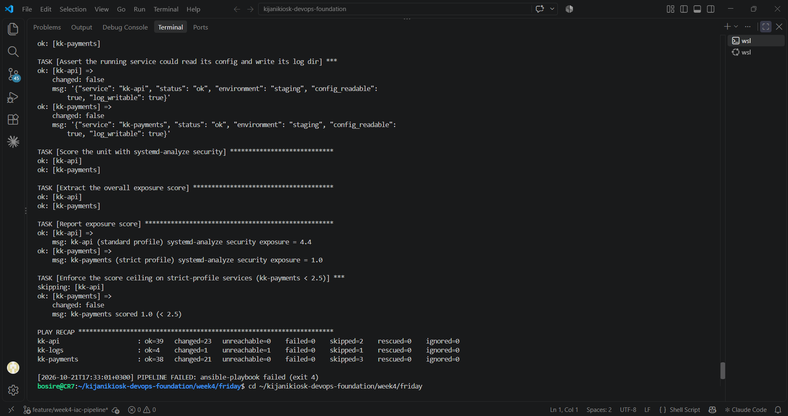
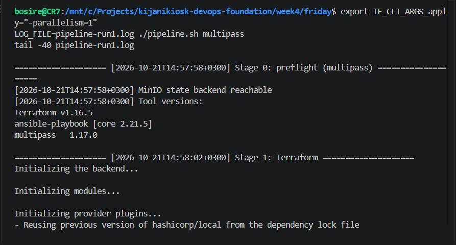
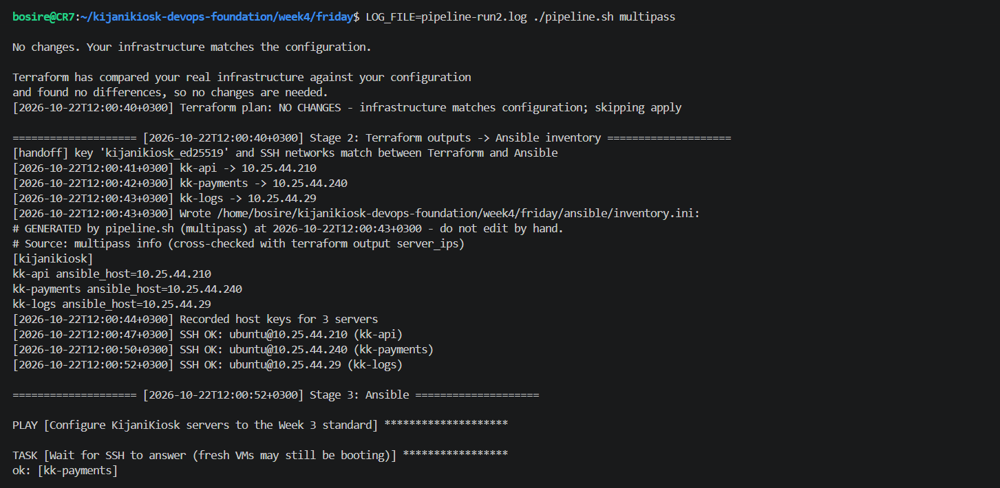
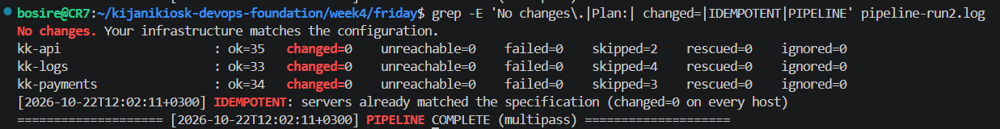
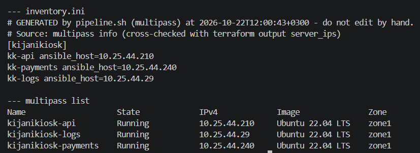
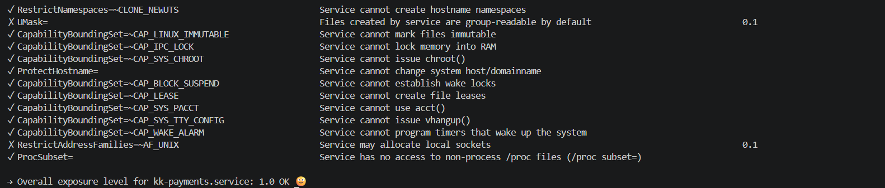
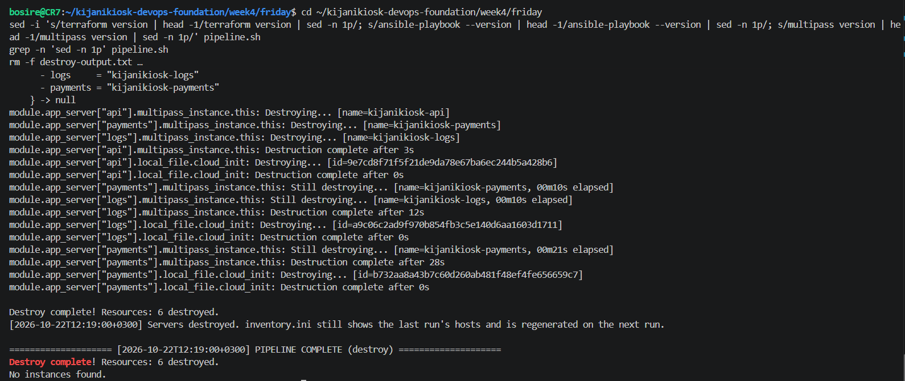

## Evidence

| Proof | File |
| :--- | :--- |
| Run 1: Terraform apply + Ansible configure (all hosts `failed=0`) | [`pipeline-run1.log`](pipeline-run1.log) ·  |
| State survived between runs in MinIO (Challenge E) |  |
| Run 2: Terraform `No changes` | [`pipeline-run2.log`](pipeline-run2.log) ·  |
| Run 2: Ansible `changed=0` on every host |  |
| Inventory generated from live IPs |  |
| kk-payments `systemd-analyze security` = 1.0 (< 2.5) |  |
| Clean teardown | [`destroy-output.txt`](destroy-output.txt) ·  |
| Failure handling: an earlier run stopped with a non-zero exit when one host timed out | [`pipeline-run1-failed-attempt.log`](pipeline-run1-failed-attempt.log) |
