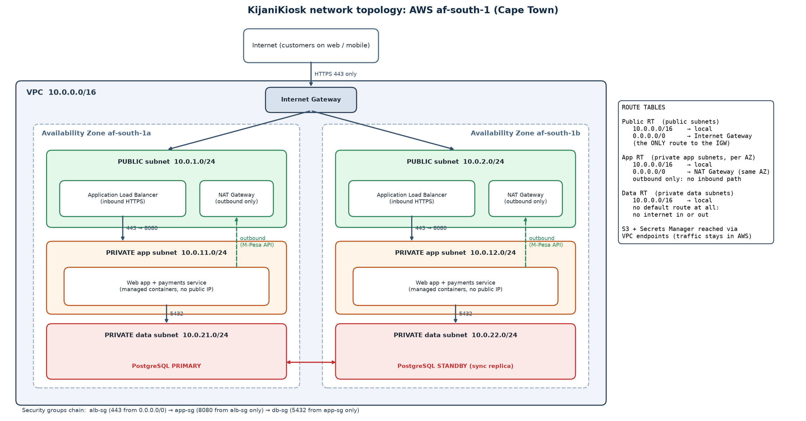

# KijaniKiosk DevOps Starter Kit

The engineering foundations for the KijaniKiosk platform, documented before the system grows.

| Topic | File |
|---|---|
| Flow, Feedback and Learning in our workflow | [delivery-notes.md](delivery-notes.md) |
| IaaS vs PaaS vs SaaS decision | [cloud-model.md](cloud-model.md) |
| Region selection and multi-AZ reliability | [regions-azs.md](regions-azs.md) |
| Least-privilege IAM role for the payments service | [iam-least-privilege.md](iam-least-privilege.md) |
| Public/private subnet architecture and routing | [network-topology.png](network-topology.png) (explained below) |

## Network architecture

- **One VPC (`10.0.0.0/16`) across two AZs**, with three subnet tiers per AZ: public, private app and private data.
- **Public subnets** (`10.0.1.0/24`, `10.0.2.0/24`) hold only the Application Load Balancer and one NAT gateway per AZ. Their route table is the **only** one with `0.0.0.0/0 → Internet Gateway`, so they are the only subnets with internet routing.
- **Private app subnets** (`10.0.11.0/24`, `10.0.12.0/24`) run the web app and payments service with no public IPs. Their route table sends `0.0.0.0/0` to the **NAT gateway in the same AZ**. This is outbound-only: the payments service can call the M-Pesa Daraja API, but nothing on the internet can open a connection to it. A NAT per AZ means losing one AZ does not cut the other AZ's outbound path.
- **Private data subnets** (`10.0.21.0/24`, `10.0.22.0/24`) hold the PostgreSQL primary and standby. Their route table has **only `10.0.0.0/16 → local`** and no default route, so the database cannot reach the internet and the internet cannot reach it.
- **VPC endpoints** for S3 (gateway) and Secrets Manager (interface) keep receipt and secret traffic on the AWS network instead of going through the NAT.
- **Security groups add a second layer:** `alb-sg` accepts 443 from anywhere → `app-sg` accepts 8080 **only from `alb-sg`** → `db-sg` accepts 5432 **only from `app-sg`**. The database is two hops from the internet and accepts traffic from exactly one source.

## Reflection

**Where was I tempted to take shortcuts?**
In the IAM policy. Granting `s3:*` on the bucket would have "worked" and been quicker to write. Narrowing it forced me to ask what the payments service really does. It turned out it never needs to list or delete, so the final policy is two S3 actions on one prefix. I was also tempted to draw a single public and a single private subnet. That meets the brief literally, but it puts everything in one AZ, which contradicts my own multi-AZ reasoning.

**Which architectural decision required the most reasoning?**
Whether private subnets should have any outbound internet access. My first design gave them none, which was the most locked-down option. Then I realised the payments service must *call* the M-Pesa API to start a payment, so that design could not work. The result treats the tiers differently: the app subnets get outbound-only access through a NAT gateway (no inbound path), and the data subnets get no default route at all, because a database has no reason to talk to the internet and every outbound path is a potential data-exfiltration path. Only the public subnets route to the Internet Gateway.

**If KijaniKiosk grows significantly, what would I improve first?**
I would turn this documentation into **Infrastructure as Code** (Terraform) with automated checks on every pull request. Today the VPC, subnets and IAM policy exist as documents. A reviewer has to trust that what is built matches what is written. With code, the PR shows the exact change, and tools can validate the IAM policy and catch an accidental `0.0.0.0/0` route before it is applied. After that, I would add a third AZ and cross-region backups.
